# Assignment 1: Automated EC2 Instance Management Using AWS Lambda and Boto3

## Objective

Automatically stop and start EC2 instances based on their tags, using an AWS Lambda function written in Python with Boto3.

- Instances tagged `Action = Auto-Stop` are **stopped**.
- Instances tagged `Action = Auto-Start` are **started**.

## Environment

| Item | Value |
|---|---|
| Region | Asia Pacific (Sydney), `ap-southeast-2` |
| Instance type | `t3.micro` (Free plan eligible in Sydney) |
| AMI | Amazon Linux 2023 |
| Lambda runtime | Python 3.x |
| Lambda function | `ec2-tag-start-stop` |
| IAM role | `lambda-ec2-tag-start-stop-role` |

## How it works

```
Manual test invoke
        │
        ▼
Lambda: ec2-tag-start-stop  (assumes lambda-ec2-tag-start-stop-role)
        │
        ├─ describe_instances  (tag:Action = Auto-Stop,  state = running) ──► stop_instances
        ├─ describe_instances  (tag:Action = Auto-Start, state = stopped) ──► start_instances
        │
        └─ print() affected instance IDs ──► CloudWatch Logs
```

---

## Step 1: EC2 setup

Two `t3.micro` instances were launched in Sydney, without a key pair and with no inbound security group rules. They are controlled only through the EC2 API, so no SSH access is needed. Both share the security group `launch-wizard-1`.

| Name | Instance ID | Tag |
|---|---|---|
| `lab-auto-stop` | `i-08979bc2b7fb10e61` | `Action = Auto-Stop` |
| `lab-auto-start` | `i-046d948319f24f8c7` | `Action = Auto-Start` |

**`lab-auto-stop` instance details** (t3.micro, ap-southeast-2, running):

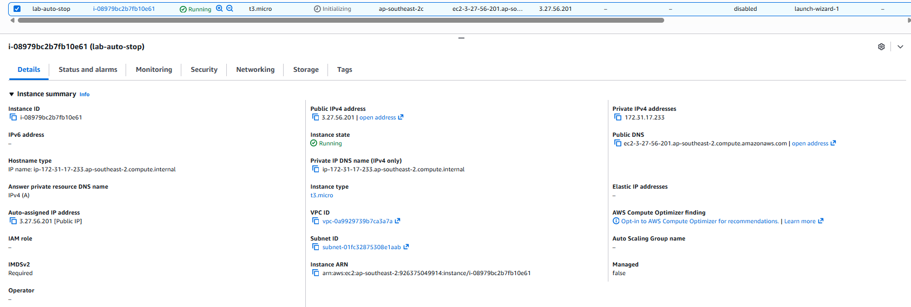

**Tags on `lab-auto-stop`:**

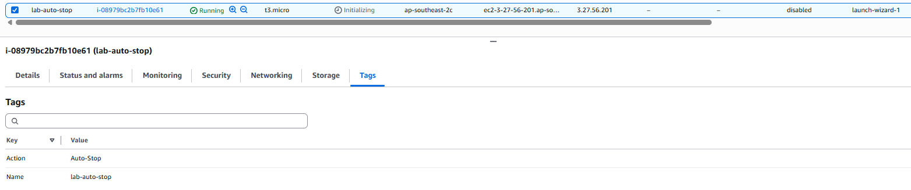

**Tags on `lab-auto-start`:**

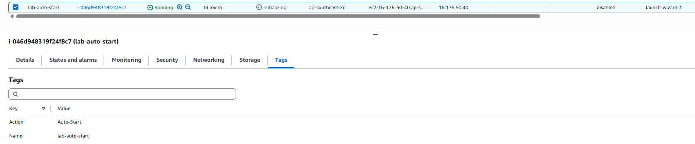

To make the result visible, `lab-auto-start` was stopped manually before running Lambda. The **Action** tag was added as a column in the instance list so that the tag and state can be seen together.

**Before state:** `lab-auto-stop` is Running and `lab-auto-start` is Stopped.

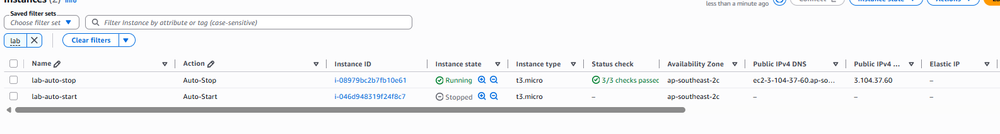

---

## Step 2: IAM role for Lambda

A role was created with **AWS service → Lambda** as the trusted entity and use case.

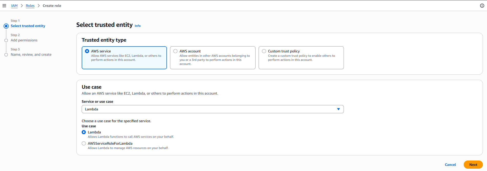

Two AWS managed policies were attached:

| Policy | Purpose |
|---|---|
| `AmazonEC2FullAccess` | Describe, stop and start EC2 instances (as specified by the assignment) |
| `AWSLambdaBasicExecutionRole` | Write the function's logs to CloudWatch Logs; without it, `print()` output is not recorded |

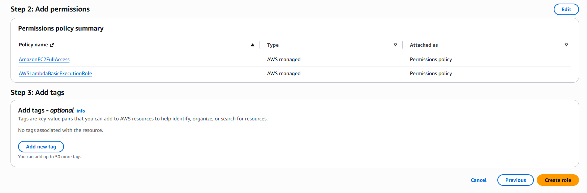

The role was named `lambda-ec2-tag-start-stop-role`. The trust policy allows only the Lambda service (`lambda.amazonaws.com`) to assume it via `sts:AssumeRole`.

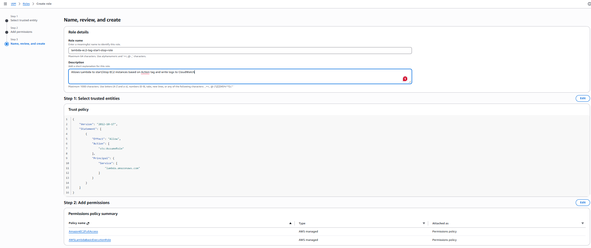

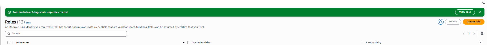

---

## Step 3: Lambda function

The function `ec2-tag-start-stop` was created in Sydney with **Author from scratch** and a Python 3.x runtime. Lambda is a regional service, so it must be in the same region as the instances it manages.

The additional settings were left at their defaults. In particular, **VPC** was left off (a function inside a VPC without a NAT gateway or endpoint cannot reach the EC2 API) and **Function URL** was left off (no public HTTP endpoint is needed).

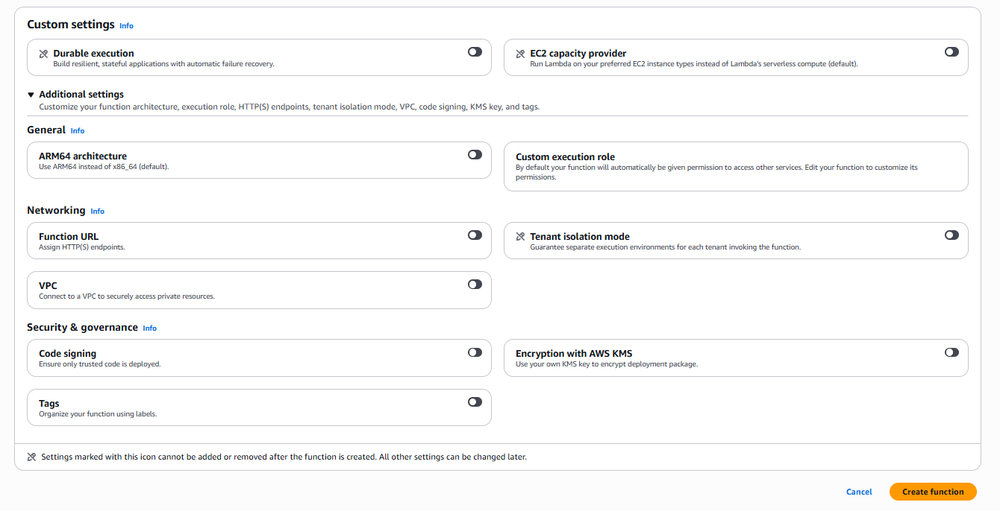

The function was created with the default template code. The ARN confirms the region is `ap-southeast-2`.

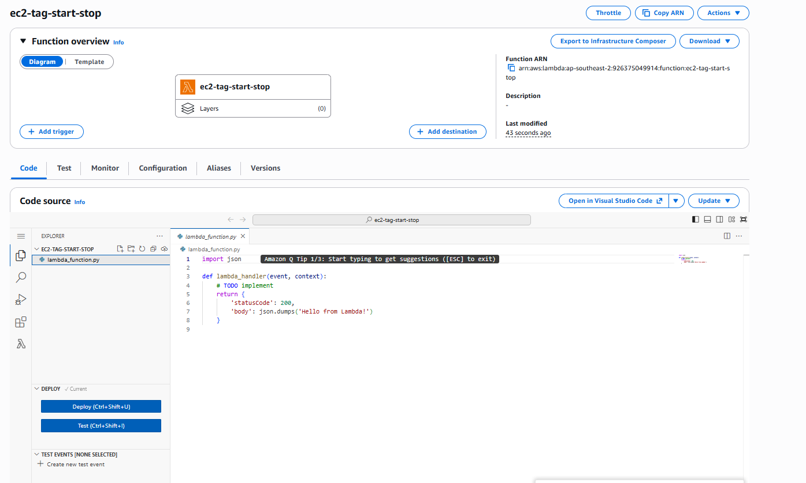

The current console does not let you select an existing role during creation; it creates an auto-generated role with logging permissions only. The execution role was therefore changed afterwards under **Configuration → Permissions → Edit** to `lambda-ec2-tag-start-stop-role`.

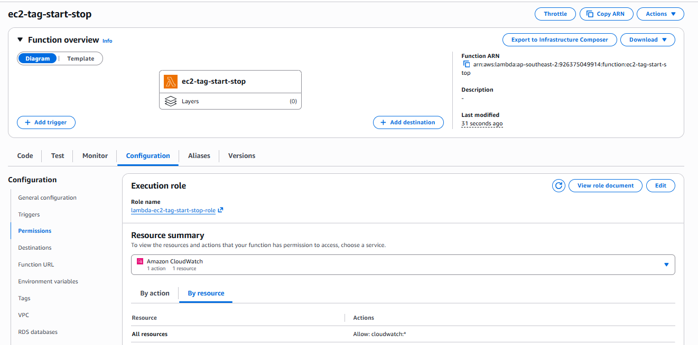

---

## Step 4: Code

Full source: [`lambda_function.py`](lambda_function.py)

```python
import boto3

ec2 = boto3.client("ec2")


def get_instance_ids(tag_value, states):
    instance_ids = []
    paginator = ec2.get_paginator("describe_instances")
    pages = paginator.paginate(
        Filters=[
            {"Name": "tag:Action", "Values": [tag_value]},
            {"Name": "instance-state-name", "Values": states},
        ]
    )
    for page in pages:
        for reservation in page["Reservations"]:
            for instance in reservation["Instances"]:
                instance_ids.append(instance["InstanceId"])
    return instance_ids


def lambda_handler(event, context):
    to_stop = get_instance_ids("Auto-Stop", ["running"])
    to_start = get_instance_ids("Auto-Start", ["stopped"])

    if to_stop:
        ec2.stop_instances(InstanceIds=to_stop)
        print(f"Stopping instances (Action=Auto-Stop): {to_stop}")
    else:
        print("No running instances tagged Action=Auto-Stop")

    if to_start:
        ec2.start_instances(InstanceIds=to_start)
        print(f"Starting instances (Action=Auto-Start): {to_start}")
    else:
        print("No stopped instances tagged Action=Auto-Start")

    return {"stopped": to_stop, "started": to_start}
```

The code was pasted into the console editor and deployed.

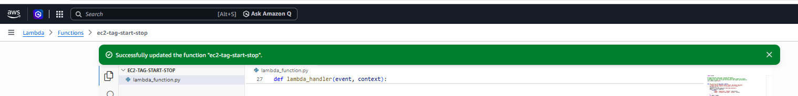

### Code walkthrough

1. **Client setup:** `boto3.client("ec2")` is created outside the handler so warm invocations reuse it. No credentials are in the code; Boto3 uses the temporary credentials Lambda obtains from the execution role. With no region specified, it uses the function's own region.
2. **Finding instances by tag:** `describe_instances` is called with server-side filters on `tag:Action` and `instance-state-name`. A paginator is used so that no instances are missed when results span multiple pages.
3. **State filtering:** only *running* `Auto-Stop` instances are stopped and only *stopped* `Auto-Start` instances are started. This keeps the logs accurate (only instances that actually change are reported) and avoids errors from acting on terminated instances.
4. **Nested loop:** `describe_instances` groups instances into reservations (one per launch request), so the code loops over reservations, then over the instances within each one.
5. **Stop / start:** `stop_instances` and `start_instances` are called only when the list is non-empty, since an empty `InstanceIds` list raises an error.
6. **Logging:** affected instance IDs are printed, which sends them to CloudWatch Logs. The function also returns a summary of what it changed.

### Timeout

The default Lambda timeout is 3 seconds. The test run's billed duration was **2603 ms** (586 ms cold-start init + 2017 ms execution), leaving very little margin, so the timeout was increased to **30 seconds**. Lambda bills only for the time actually used, so this costs nothing extra.

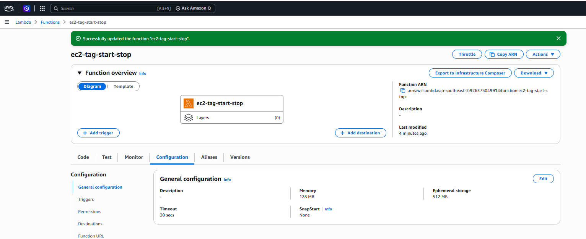

---

## Step 5: Testing

The function was invoked manually from the **Test** tab with a test event named `manual-run` containing an empty JSON object (`{}`); the code does not read any input.

**Response:**

```json
{
  "stopped": ["i-08979bc2b7fb10e61"],
  "started": ["i-046d948319f24f8c7"]
}
```

**Log output:**

```
Stopping instances (Action=Auto-Stop): ['i-08979bc2b7fb10e61']
Starting instances (Action=Auto-Start): ['i-046d948319f24f8c7']
```

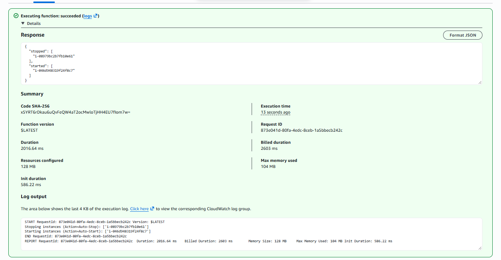

The **after** state in the EC2 console confirms the change: `lab-auto-stop` is now Stopped and `lab-auto-start` is now Running. `lab-auto-start` also received a new public IP, since AWS assigns a new public IPv4 address each time an instance starts unless an Elastic IP is attached.

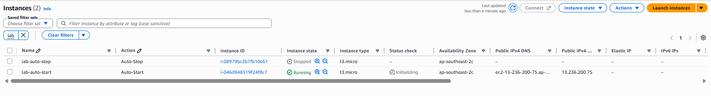

---

## Result

| Instance | Tag | Before | After |
|---|---|---|---|
| `lab-auto-stop` | `Auto-Stop` | Running | **Stopped** ✅ |
| `lab-auto-start` | `Auto-Start` | Stopped | **Running** ✅ |

---

## Security note: least privilege

`AmazonEC2FullAccess` was used as the assignment instructs, but it grants far more than this function needs (it could, for example, terminate instances or change security groups). In production, the role would use a policy limited to the three required actions, with start/stop restricted to instances that carry the `Action` tag:

```json
{
  "Version": "2012-10-17",
  "Statement": [
    {
      "Effect": "Allow",
      "Action": "ec2:DescribeInstances",
      "Resource": "*"
    },
    {
      "Effect": "Allow",
      "Action": ["ec2:StartInstances", "ec2:StopInstances"],
      "Resource": "arn:aws:ec2:*:*:instance/*",
      "Condition": {
        "StringEquals": {
          "aws:ResourceTag/Action": ["Auto-Start", "Auto-Stop"]
        }
      }
    }
  ]
}
```

`DescribeInstances` does not support resource-level restrictions, so it must use `"Resource": "*"`; the tag condition is applied to the start and stop actions.
