# Assignment 4: Automatic EBS Snapshot and Cleanup Using AWS Lambda and Boto3

## Objective

Automate the backup of an EBS volume and the cleanup of old backups:

1. Create a snapshot of a specified EBS volume.
2. Delete snapshots older than 30 days.
3. Log the IDs of created and deleted snapshots.
4. **Bonus:** run the function automatically every week using an EventBridge (CloudWatch Events) schedule.

## Environment

| Item | Value |
|---|---|
| Region | Asia Pacific (Sydney), `ap-southeast-2` |
| Source volume | `vol-0b11962a8ab6a7ac5` (8 GiB root volume of `lab-auto-stop`) |
| Lambda runtime | Python 3.x |
| Lambda function | `ebs-snapshot-cleanup` |
| IAM role | `lambda-ebs-snapshot-role` |
| Schedule | EventBridge rule `ebs-snapshot-weekly`, `cron(30 20 ? * SAT *)` |

## How it works

```
EventBridge rule (weekly)  or  manual test invoke
        │
        ▼
Lambda: ebs-snapshot-cleanup  (assumes lambda-ebs-snapshot-role)
        │   reads VOLUME_ID and RETENTION_DAYS from environment variables
        │
        ├─ create_snapshot(VOLUME_ID)  ──► tagged CreatedBy=ebs-snapshot-cleanup
        │
        ├─ describe_snapshots  (owner = self, volume = VOLUME_ID, tag CreatedBy = ebs-snapshot-cleanup)
        │       └─ older than RETENTION_DAYS (and not the new one) ──► delete_snapshot
        │
        └─ print() created / deleted snapshot IDs ──► CloudWatch Logs
```

## Design decisions

**Configurable retention.** AWS sets a snapshot's creation time itself, so a 31-day-old snapshot cannot be created for testing. The retention period is therefore read from the `RETENTION_DAYS` environment variable rather than hardcoded. The cleanup logic was proven by temporarily setting it to `0`, without changing or redeploying the code.

**Safe deletion scope.** The function only deletes snapshots that it created itself. Every snapshot it makes is tagged `CreatedBy = ebs-snapshot-cleanup`, and the cleanup query filters on that tag, on the source volume, and on `OwnerIds=["self"]`. Snapshots created manually, by other tools, or behind an AMI are never touched. This was verified during testing: an unrelated AMI snapshot in the account survived a run with a 0-day retention.

---

## Step 1: Identify the volume

The root volume of the `lab-auto-stop` instance was chosen. The instance is stopped, so nothing is writing to the disk and the snapshot is fully consistent.

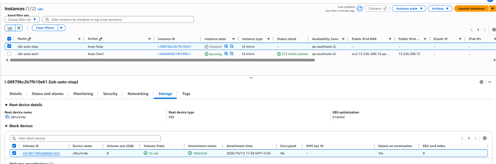

---

## Step 2: IAM role

A dedicated role, `lambda-ebs-snapshot-role`, was created with **AWS service → Lambda** as the trusted entity. A separate role per function means a permission change or compromise affects only one function.

| Policy | Purpose |
|---|---|
| `AmazonEC2FullAccess` | Create, describe and delete EBS snapshots (as specified by the assignment) |
| `AWSLambdaBasicExecutionRole` | Write the function's logs to CloudWatch Logs |

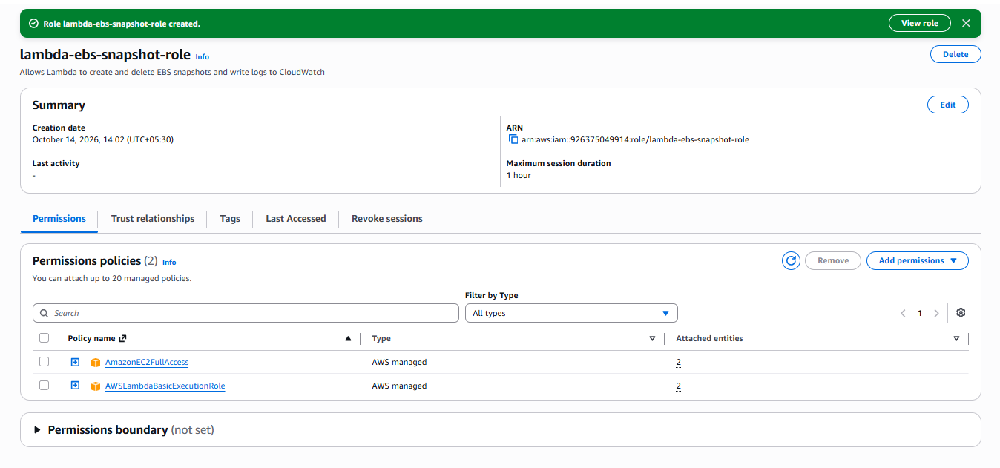

---

## Step 3: Lambda function

The function `ebs-snapshot-cleanup` was created in Sydney with a Python 3.x runtime.

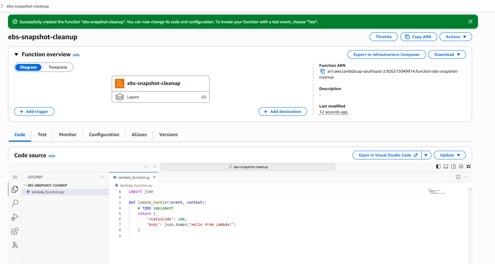

The execution role was set to `lambda-ebs-snapshot-role` under **Configuration → Permissions**.

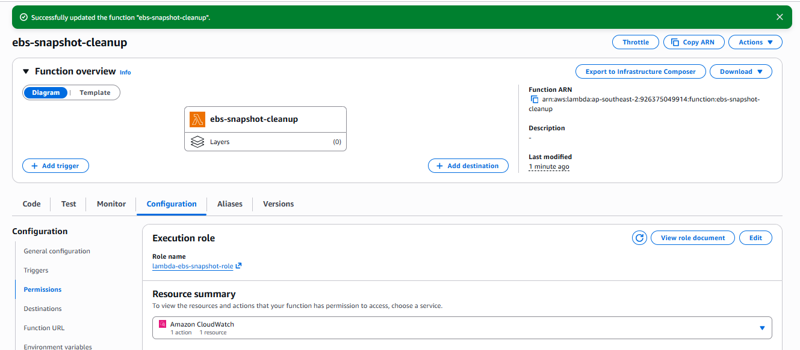

The timeout was increased from the default 3 seconds to **30 seconds**, to allow for the cold start plus several EC2 API calls.

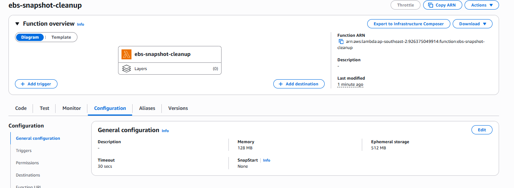

### Environment variables

| Key | Value | Purpose |
|---|---|---|
| `VOLUME_ID` | `vol-0b11962a8ab6a7ac5` | The volume to back up |
| `RETENTION_DAYS` | `30` | Snapshots older than this are deleted |

Keeping these outside the code means the same function can back up a different volume, or use a different retention period, without a code change. Lambda encrypts environment variables at rest; real secrets would still belong in Secrets Manager or SSM Parameter Store.

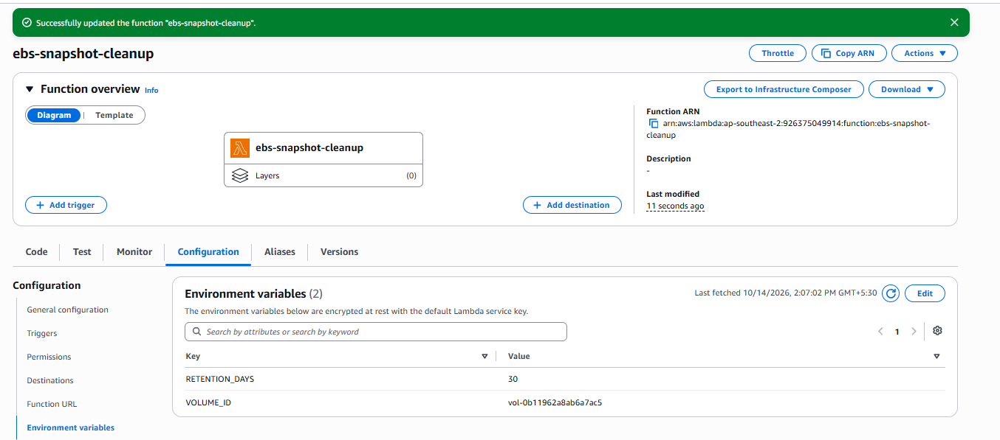

---

## Step 4: Code

Full source: [`lambda_function.py`](lambda_function.py)

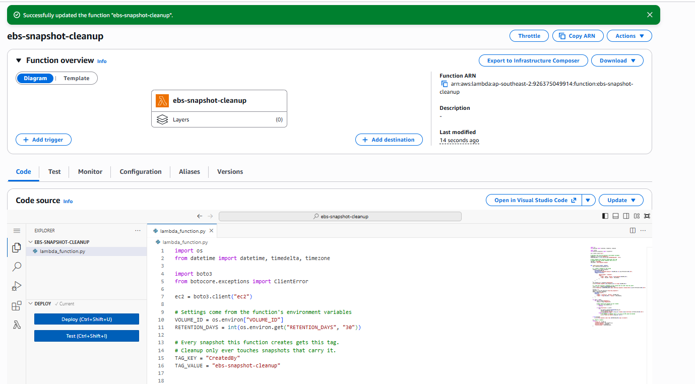

### Code walkthrough

1. **Settings:** `VOLUME_ID` is read with `os.environ[...]`, so the function fails immediately with a clear error if it is missing. `RETENTION_DAYS` falls back to 30 and is converted to an integer, since environment variables are always strings.
2. **Create:** `create_snapshot` starts the snapshot and returns its ID straight away; the snapshot completes in the background. `TagSpecifications` applies the `Name` and `CreatedBy` tags at creation time, so there is never an untagged snapshot.
3. **Find:** `describe_snapshots` is called through a paginator with three filters:
   - `OwnerIds=["self"]`: only this account's snapshots. Without it, the call also returns public snapshots shared by other accounts.
   - `volume-id`: only snapshots of the configured volume.
   - `tag:CreatedBy`: only snapshots created by this function.
4. **Age check:** `cutoff = now - RETENTION_DAYS`. Any snapshot whose `StartTime` is earlier than the cutoff is deleted. Both values are timezone-aware UTC datetimes, so the comparison is correct regardless of local time.
5. **Protect the new snapshot:** the snapshot created in the current run is always skipped. Without this, a 0-day retention could delete the backup that was just made.
6. **Error handling:** `delete_snapshot` is wrapped in `try/except ClientError`, so a snapshot that cannot be deleted (for example, one in use by an AMI) is logged and the run continues.
7. **Logging and result:** created and deleted snapshot IDs are printed to CloudWatch Logs and returned as a summary.

---

## Step 5: Testing

### Run 1: normal operation (`RETENTION_DAYS = 30`)

The function created snapshot **A** (`snap-02d21342c05b35d19`). The cutoff was `2026-09-14 08:42 UTC`, exactly 30 days earlier, and no snapshots were old enough to delete, which is the expected result on a first run.

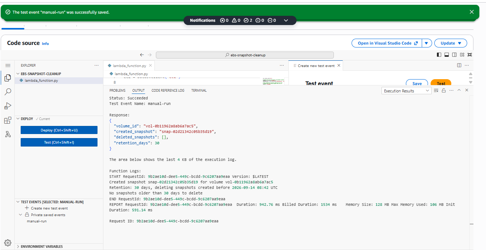

Snapshot A in the EC2 console: **Completed**, 1.59 GiB stored for an 8 GiB volume (only used blocks are stored).

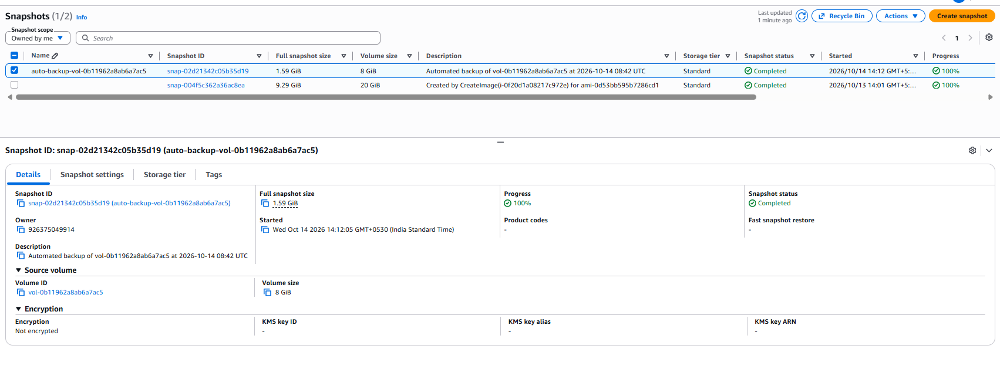

Snapshot A carries the `CreatedBy = ebs-snapshot-cleanup` tag.

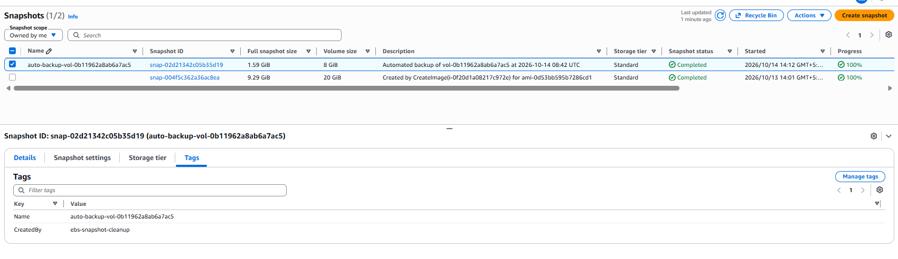

Note the second snapshot in the list, `snap-004f5c362a36ac8ea`. It belongs to an AMI from a different project, is from a different volume, and has no `CreatedBy` tag. It is used below to verify that the cleanup leaves unrelated snapshots alone.

### Run 2: cleanup test (`RETENTION_DAYS = 0`)

The retention was temporarily set to `0`, which makes every existing snapshot count as "old".

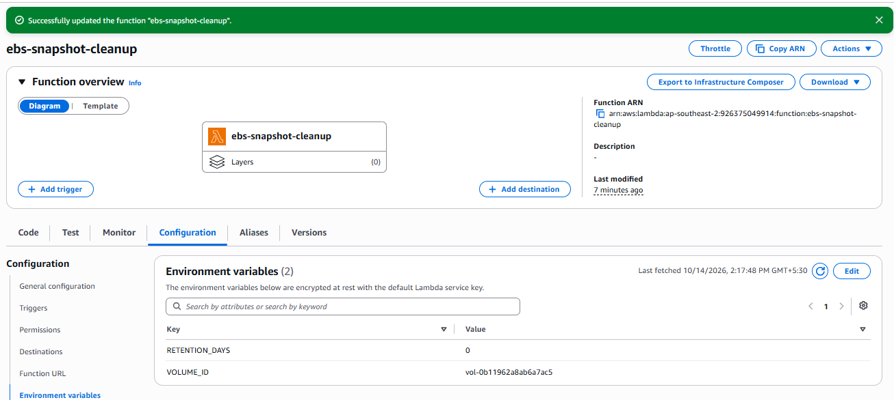

The function created snapshot **B** (`snap-0f6ffef04c7b66a6f`) and deleted snapshot **A**. Snapshot B was kept because it was created in the same run, and the AMI snapshot was not considered at all because it fails the volume and tag filters.

```
Created snapshot snap-0f6ffef04c7b66a6f for volume vol-0b11962a8ab6a7ac5
Retention: 0 days, deleting snapshots created before 2026-10-14 08:48 UTC
Deleted snapshot snap-02d21342c05b35d19 (created 2026-10-14 08:42 UTC)
```

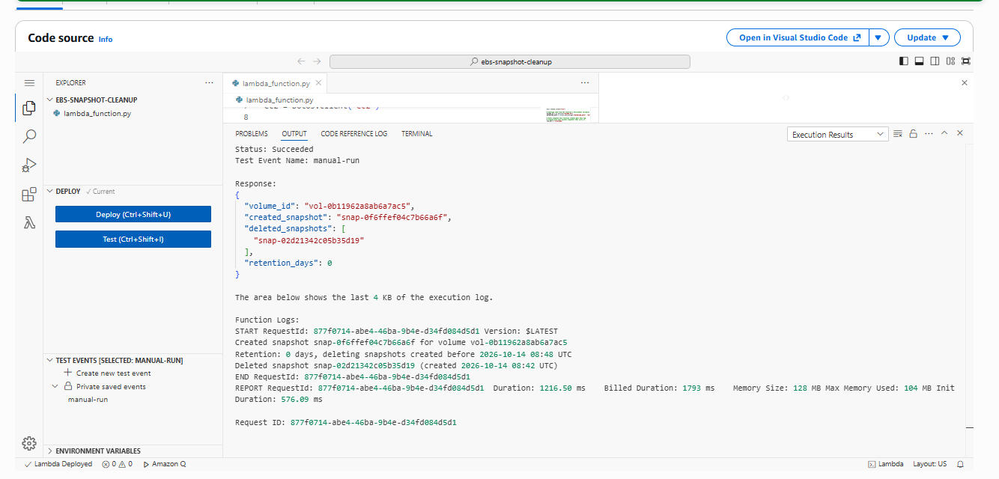

The EC2 console confirms the outcome: snapshot A is gone, snapshot B is present, and the AMI snapshot is untouched.

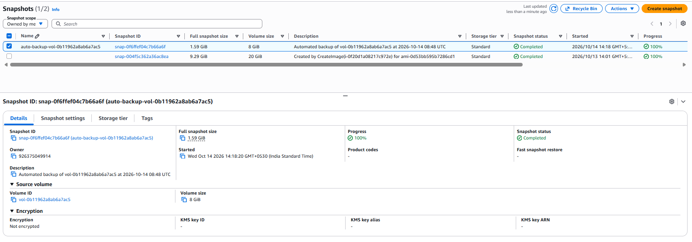

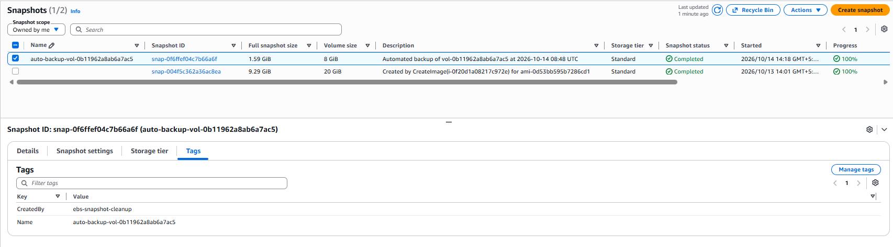

### Reset

`RETENTION_DAYS` was set back to `30` before enabling the schedule. Leaving it at `0` would delete every previous backup on each run, leaving only one.

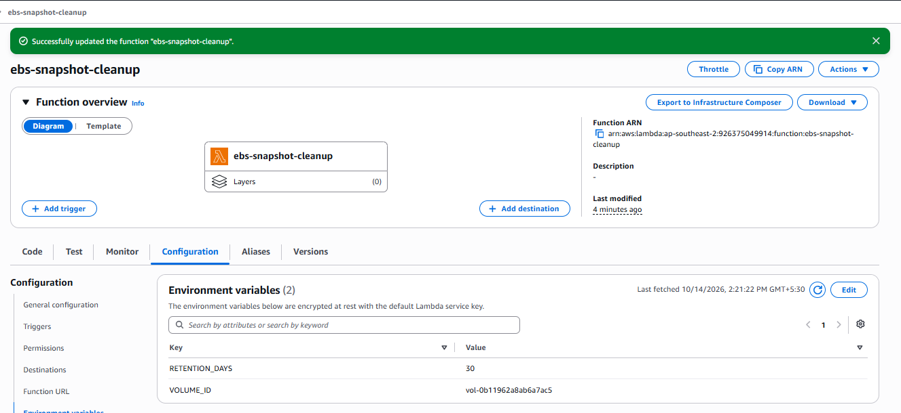

### Test summary

| Snapshot | Created by | Run 1 (30 days) | Run 2 (0 days) |
|---|---|---|---|
| A `snap-02d21342c05b35d19` | This function | Created | **Deleted** ✅ |
| B `snap-0f6ffef04c7b66a6f` | This function | – | Created, **kept** ✅ |
| `snap-004f5c362a36ac8ea` (AMI) | CreateImage | Untouched | **Untouched** ✅ |

---

## Step 6 (Bonus): Weekly schedule with EventBridge

An EventBridge rule, `ebs-snapshot-weekly`, invokes the function every **Sunday at 02:00 IST**. EventBridge schedules run in UTC, so this is **Saturday 20:30 UTC**:

```
cron(30 20 ? * SAT *)
      │  │  │ │  │  └─ any year
      │  │  │ │  └──── Saturday (UTC)
      │  │  │ └─────── every month
      │  │  └───────── any day of month ("?" is required when day-of-week is set)
      │  └──────────── 20:00 UTC hour
      └─────────────── minute 30
```

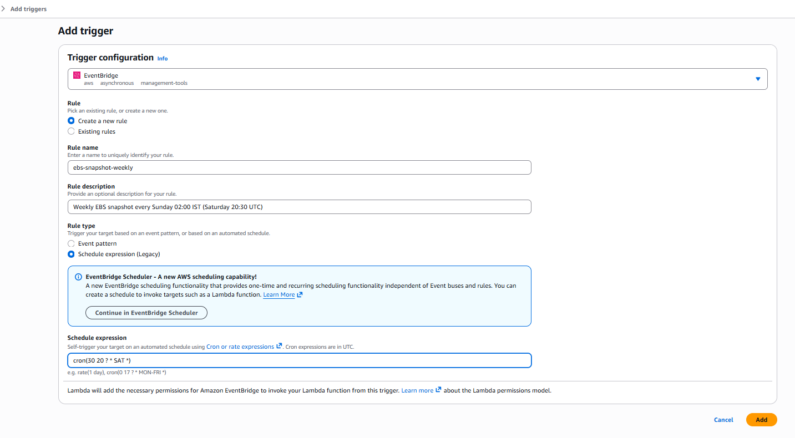

The rule is **ENABLED** and appears as a trigger on the function. Adding the trigger from the Lambda console also created a resource-based policy statement allowing `events.amazonaws.com` to invoke the function.

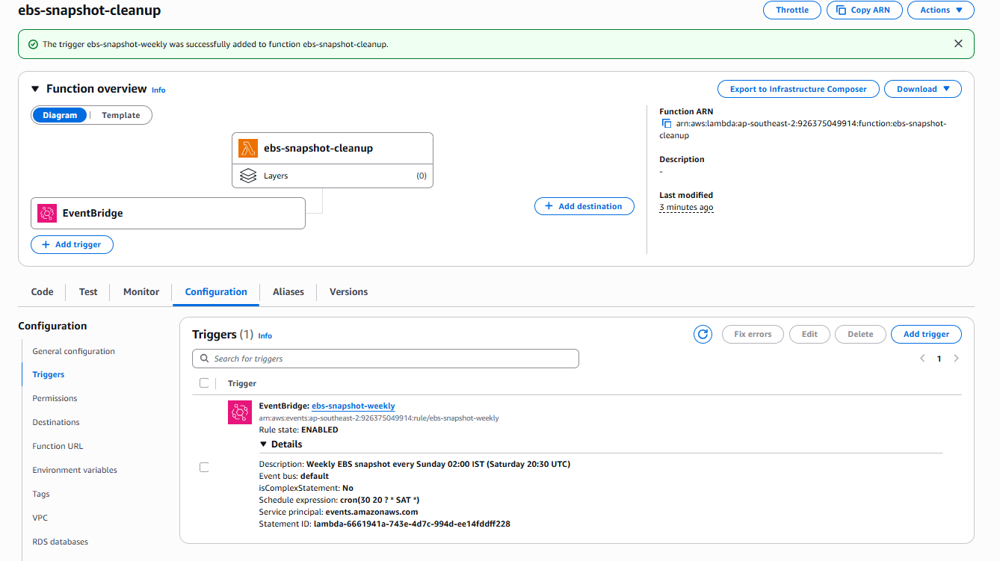

The console labels this rule type "Schedule expression (Legacy)". **EventBridge Scheduler** is the newer AWS service for schedules and supports time zones directly (so `Asia/Kolkata` could be used instead of converting to UTC). An EventBridge rule was used here because the assignment specifies CloudWatch Events.

---

## Security and production notes

**Least privilege.** `AmazonEC2FullAccess` was used as instructed, but the function only needs four actions. A production policy would also restrict deletion to snapshots carrying the function's tag:

```json
{
  "Version": "2012-10-17",
  "Statement": [
    {
      "Effect": "Allow",
      "Action": "ec2:DescribeSnapshots",
      "Resource": "*"
    },
    {
      "Effect": "Allow",
      "Action": "ec2:CreateSnapshot",
      "Resource": [
        "arn:aws:ec2:ap-southeast-2:*:volume/vol-0b11962a8ab6a7ac5",
        "arn:aws:ec2:ap-southeast-2::snapshot/*"
      ]
    },
    {
      "Effect": "Allow",
      "Action": "ec2:CreateTags",
      "Resource": "arn:aws:ec2:ap-southeast-2::snapshot/*",
      "Condition": {
        "StringEquals": { "ec2:CreateAction": "CreateSnapshot" }
      }
    },
    {
      "Effect": "Allow",
      "Action": "ec2:DeleteSnapshot",
      "Resource": "arn:aws:ec2:ap-southeast-2::snapshot/*",
      "Condition": {
        "StringEquals": { "aws:ResourceTag/CreatedBy": "ebs-snapshot-cleanup" }
      }
    }
  ]
}
```

With this policy, the tag-based safety rule is enforced by IAM as well as by the code: even a bug in the function could not delete another team's snapshots.

**Encryption.** The source volume is unencrypted, so its snapshots are too. In production, enabling **EBS encryption by default** for the region ensures every new volume and snapshot is encrypted.

**Resilience.** Snapshots are stored in the same region as the volume. For disaster recovery, copies would also be sent to another region or a separate backup account.

**Managed alternatives.** AWS Data Lifecycle Manager and AWS Backup provide this snapshot-and-retention behaviour as managed services. A custom Lambda function is useful when the logic needs to go beyond what those services offer, and it is what this assignment requires.
