# Assignment 5: Auto-Tagging EC2 Instances on Launch Using AWS Lambda and Boto3

## Objective

Automatically tag every newly launched EC2 instance with the current date and a custom tag, using a Lambda function triggered by an EventBridge (CloudWatch Events) rule.

| Tag key | Value | Purpose |
|---|---|---|
| `LaunchDate` | Launch date in UTC, e.g. `2026-10-14` | The current date, as required |
| `ManagedBy` | `auto-tagger-lambda` | Custom tag identifying the automation that applied the tags |

## Environment

| Item | Value |
|---|---|
| Region | Asia Pacific (Sydney), `ap-southeast-2` |
| Lambda runtime | Python 3.14 |
| Lambda function | `ec2-auto-tag-on-launch` |
| IAM role | `lambda-ec2-auto-tag-role` |
| EventBridge rule | `ec2-launch-auto-tag` (event pattern) |

## How it works

```
EC2 instance launched
        │  instance enters "pending" state
        ▼
EventBridge rule: ec2-launch-auto-tag
        │  pattern: source aws.ec2, EC2 Instance State-change Notification, state = pending
        ▼
Lambda: ec2-auto-tag-on-launch  (assumes lambda-ec2-auto-tag-role)
        │  reads detail.instance-id and time from the event
        │
        ├─ describe_tags: does the instance already have LaunchDate?
        │       ├─ yes ──► skip (restart of an existing instance)
        │       └─ no  ──► create_tags: LaunchDate, ManagedBy
        │
        └─ print() confirmation ──► CloudWatch Logs
```

Unlike a scheduled or manually invoked function, this one is **event-driven**: AWS invokes it automatically when an instance launches, and the input event carries the instance ID.

## Design decisions

**Trigger on the state-change event.** EC2 publishes an "EC2 Instance State-change Notification" whenever an instance changes state, and a new launch first enters `pending`. This event is available in EventBridge without any extra setup. The alternative, the CloudTrail `RunInstances` API event, fires only on true launches and identifies who launched the instance, but EventBridge only receives it when a CloudTrail trail is configured.

**Idempotency.** Starting a *stopped* instance also passes through `pending`, so the rule fires on restarts too. Without a check, every restart would overwrite the original launch date. The function therefore skips any instance that already has a `LaunchDate` tag. This also handles EventBridge's at-least-once delivery: if the same event is delivered twice, the second delivery is skipped.

**Date source.** The date is taken from the event's `time` field (when the state change happened) rather than Lambda's clock, and is in UTC for consistency across regions. An instance launched between 00:00 and 05:30 IST therefore receives the previous day's date.

---

## Step 1: IAM role

A dedicated role, `lambda-ec2-auto-tag-role`, was created with two AWS managed policies.

| Policy | Purpose |
|---|---|
| `AmazonEC2FullAccess` | Read and create EC2 tags (as specified by the assignment) |
| `AWSLambdaBasicExecutionRole` | Write the function's logs to CloudWatch Logs |

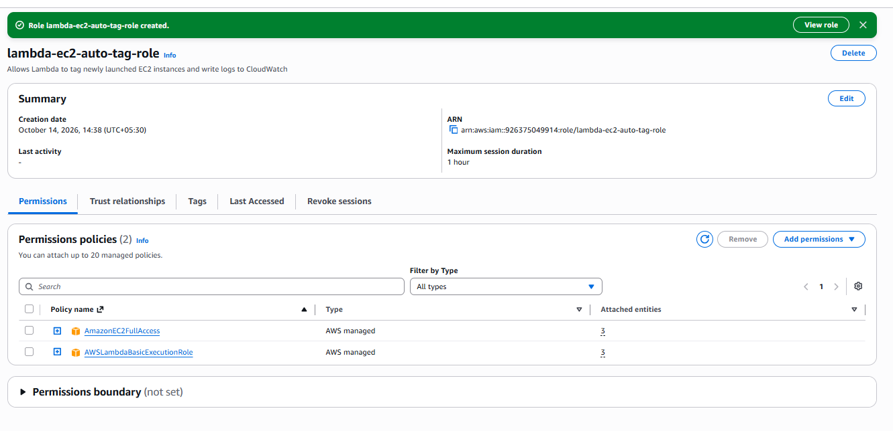

The trust policy allows only the Lambda service to assume the role.

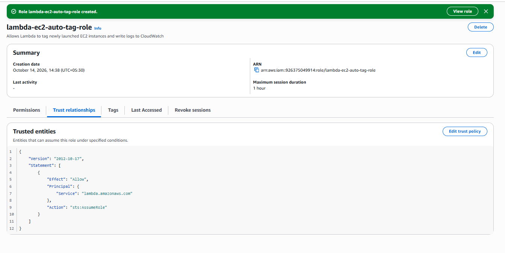

---

## Step 2: Lambda function

The function `ec2-auto-tag-on-launch` was created in Sydney with a Python runtime.

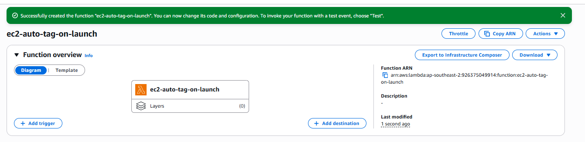

The execution role was set to `lambda-ec2-auto-tag-role`.

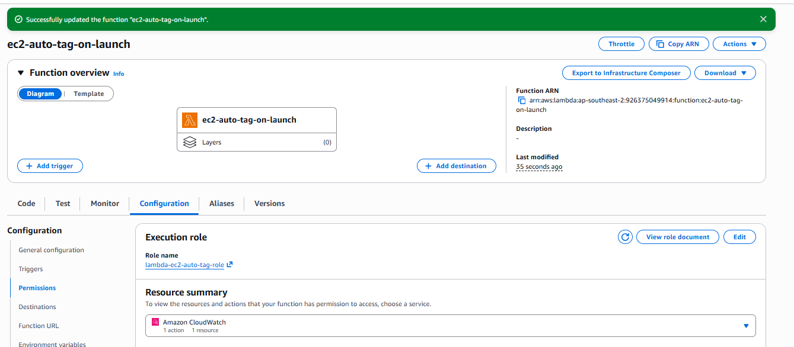

The timeout was increased from 3 seconds to **30 seconds** to allow for cold starts. No environment variables are needed: everything the function works on arrives in the event.

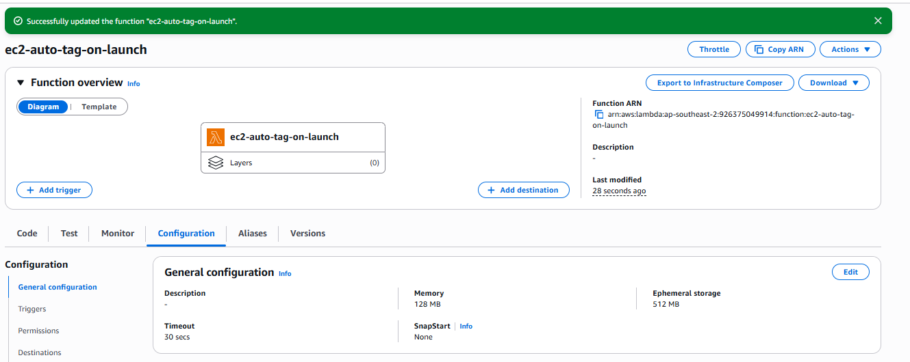

---

## Step 3: Code

Full source: [`lambda_function.py`](lambda_function.py)

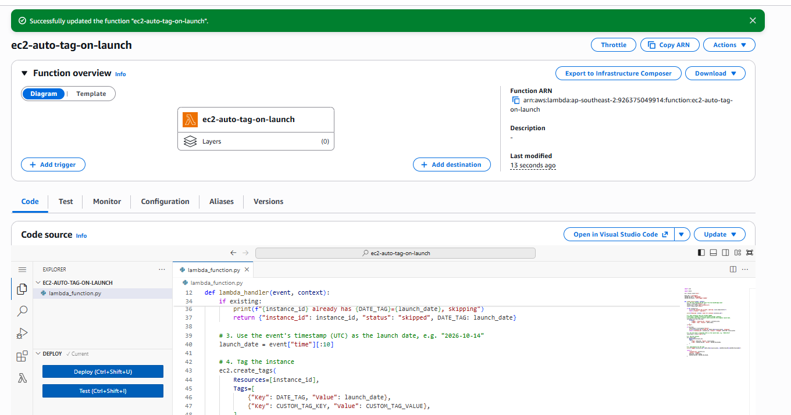

### The input event

EventBridge delivers an event like this (abbreviated):

```json
{
  "detail-type": "EC2 Instance State-change Notification",
  "source": "aws.ec2",
  "time": "2026-10-14T09:21:33Z",
  "region": "ap-southeast-2",
  "detail": {
    "instance-id": "i-07e282f42e152e152",
    "state": "pending"
  }
}
```

### Code walkthrough

1. **Read the event:** `detail.instance-id` and `detail.state` are read with `.get()`, so an unexpected event without these fields is logged in full and ignored instead of raising a `KeyError`.
2. **Idempotency check:** `describe_tags` filtered on the instance ID and the `LaunchDate` key. If the tag exists, the instance is not new, and the function logs and skips it.
3. **Launch date:** the first 10 characters of the event's `time` field give the date in `YYYY-MM-DD` format.
4. **Tag:** `create_tags` applies both tags in a single API call.
5. **Log and return:** a confirmation message is printed to CloudWatch Logs, and a summary is returned.

---

## Step 4: EventBridge rule

The trigger was added from the Lambda console as a new EventBridge rule, `ec2-launch-auto-tag`, of type **Event pattern**:

```json
{
  "source": ["aws.ec2"],
  "detail-type": ["EC2 Instance State-change Notification"],
  "detail": {
    "state": ["pending"]
  }
}
```

- `source` limits it to EC2 events.
- `detail-type` limits it to instance state changes.
- `detail.state` limits it to `pending`, so stops, terminations and other state changes do not invoke the function.

The rule is **ENABLED**. Adding it from the Lambda console also created a resource-based policy statement allowing `events.amazonaws.com` to invoke the function.

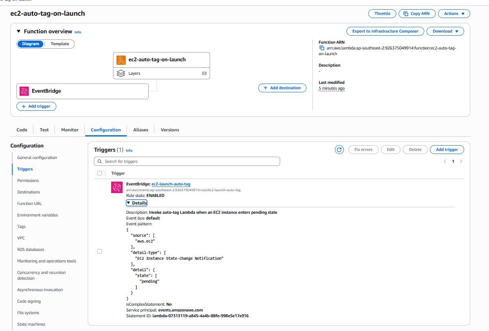

---

## Step 5: Testing

### Test 1: new instance launch

A new `t3.micro` instance, `lab-autotag-test` (`i-07e282f42e152e152`), was launched with **only a `Name` tag**.

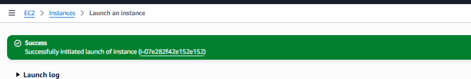

Within seconds, the function added `LaunchDate = 2026-10-14` and `ManagedBy = auto-tagger-lambda`, with no manual action.

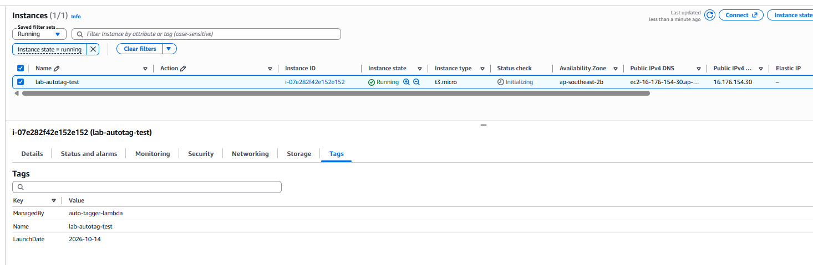

The CloudWatch Logs for the function show the event arriving and the tags being applied:

```
Received 'pending' event for instance i-07e282f42e152e152
Tagged i-07e282f42e152e152: LaunchDate=2026-10-14, ManagedBy=auto-tagger-lambda
```

The run took 582 ms plus a 633 ms cold start (`INIT_START`), well within the timeout.

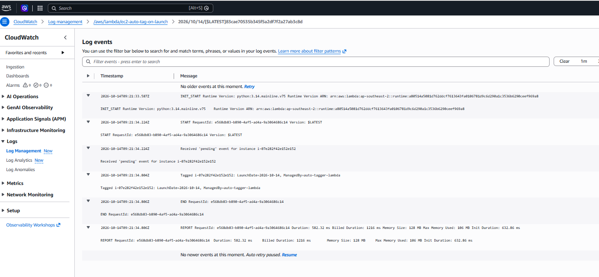

### Test 2: restart does not re-tag (idempotency)

The instance was stopped, then started again. Stopping does not invoke the function, since `stopping` and `stopped` do not match the pattern.

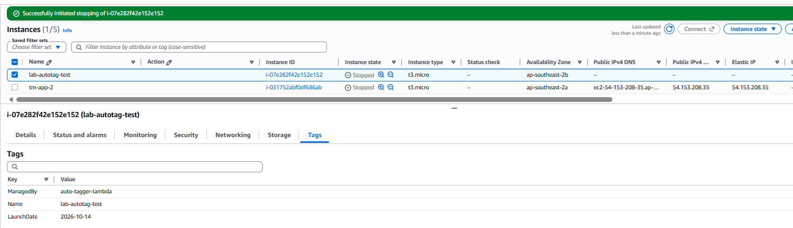

After the restart, the instance has the same three tags.

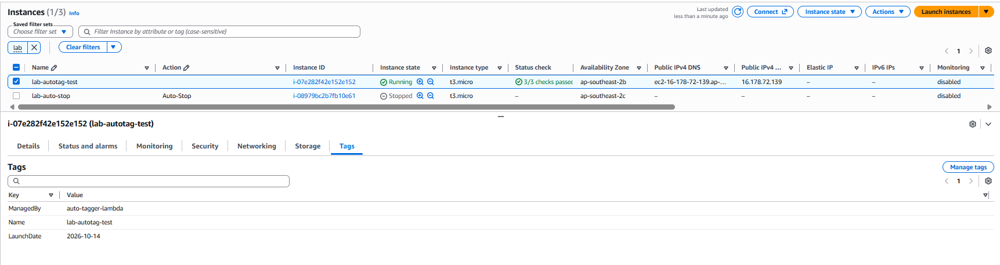

The restart passed through `pending`, so the rule invoked the function again, as expected. The function found the existing `LaunchDate` tag and skipped the instance. Because the test ran on the same day, the date value alone could not show this; the log message is the proof:

```
Received 'pending' event for instance i-07e282f42e152e152
i-07e282f42e152e152 already has LaunchDate=2026-10-14, skipping
```

This run took 319 ms compared with 582 ms for the launch, since it made no `create_tags` call. It was handled by a new execution environment (new log stream and a fresh `INIT_START`), because the earlier environment had been shut down after being idle.

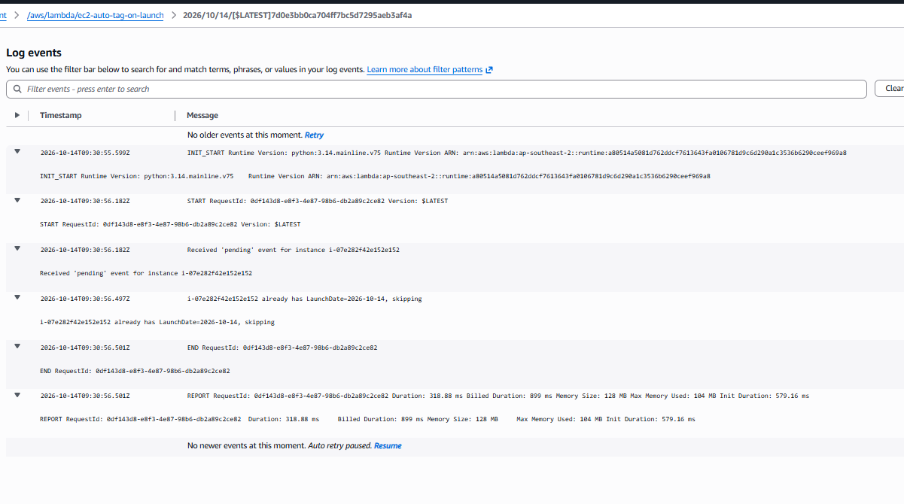

### Cleanup

The test instance was terminated after testing. Termination does not invoke the function, since `shutting-down` and `terminated` do not match the pattern.

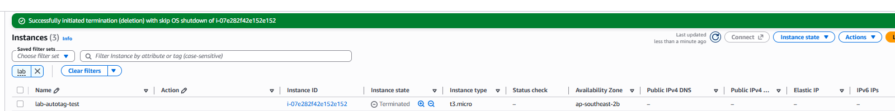

### Test summary

| Action | Function invoked? | Result |
|---|---|---|
| Launch new instance | Yes (`pending`) | Tagged with `LaunchDate` and `ManagedBy` ✅ |
| Stop instance | No | – |
| Start instance | Yes (`pending`) | Skipped, original tags kept ✅ |
| Terminate instance | No | – |

### Known limitation

The function treats any instance without a `LaunchDate` tag as new. Instances that existed **before** the function was deployed have no `LaunchDate` tag, so the first time one of them is started, it receives that day's date rather than its real launch date. This was observed during Assignment 14 testing, when `lab-auto-stop` (launched on 2026-10-13) was started on 2026-10-14. Using the CloudTrail `RunInstances` event would avoid this, since it fires only on genuine launches.

---

## Security and production notes

**Least privilege.** `AmazonEC2FullAccess` was used as instructed, but the function only needs to read tags and create two specific tags on instances. A production policy would be:

```json
{
  "Version": "2012-10-17",
  "Statement": [
    {
      "Effect": "Allow",
      "Action": "ec2:DescribeTags",
      "Resource": "*"
    },
    {
      "Effect": "Allow",
      "Action": "ec2:CreateTags",
      "Resource": "arn:aws:ec2:ap-southeast-2:*:instance/*",
      "Condition": {
        "ForAllValues:StringEquals": {
          "aws:TagKeys": ["LaunchDate", "ManagedBy"]
        }
      }
    }
  ]
}
```

The `aws:TagKeys` condition means the function can only ever write these two tag keys, so it could not, for example, change a `Name` or a cost-allocation tag.

**Recording who launched an instance.** For audit purposes, an `Owner` or `CreatedBy` tag is often more valuable than a date. That requires the CloudTrail `RunInstances` event (with a trail configured), whose `userIdentity` field identifies the launching principal.

**Tag enforcement.** Tagging after launch leaves a few seconds where the instance is untagged. Where tags are mandatory, AWS Organizations tag policies, or an IAM condition requiring tags in the `RunInstances` request, enforce them at launch instead.
