# Assignment 14: Monitor EC2 Instance State Changes Using AWS Lambda, Boto3, and SNS

## Objective

Automatically send an email notification whenever an EC2 instance is started or stopped, using an EventBridge rule, a Lambda function, and an SNS topic.

## Environment

| Item | Value |
|---|---|
| Region | Asia Pacific (Sydney), `ap-southeast-2` |
| SNS topic | `ec2-state-change-alerts` (Standard), email subscription |
| Lambda runtime | Python 3.14 |
| Lambda function | `ec2-state-change-alert` |
| IAM role | `lambda-ec2-state-alert-role` |
| EventBridge rule | `ec2-state-change-alert` (event pattern) |

## How it works

```
EC2 instance reaches "running" or "stopped"
        │
        ▼
EventBridge rule: ec2-state-change-alert
        │  pattern: source aws.ec2, EC2 Instance State-change Notification, state = running | stopped
        ▼
Lambda: ec2-state-change-alert  (assumes lambda-ec2-state-alert-role)
        │  reads instance ID, state, region and time from the event
        ├─ describe_tags ──► instance Name tag (for a readable alert)
        ├─ sns.publish   ──► topic ec2-state-change-alerts ──► email subscriber
        └─ print() state change and SNS MessageId ──► CloudWatch Logs
```

## Design decisions

**Final states only.** The rule matches `running` and `stopped`, not the transitional `pending` and `stopping` states. Matching all four would send two emails for every action ("starting…" and then "started").

**Readable alerts.** The event contains only the instance ID, so the function looks up the `Name` tag. The email subject reads `EC2 STOPPED: lab-auto-stop (i-…)`, so the inbox preview alone tells the reader what happened. The body shows the time in both UTC (to match AWS logs) and IST (for the reader), plus a direct console link to the instance.

**Alert first.** The name lookup is wrapped in error handling: if it fails, the alert is still sent with a placeholder name. In alerting code, a non-essential step should never stop the alert itself.

**Topic ARN as configuration.** The SNS topic ARN is read from the `SNS_TOPIC_ARN` environment variable, so alerts can be redirected to another topic without a code change.

---

## Step 1: SNS topic and email subscription

A **Standard** topic named `ec2-state-change-alerts` was created with the display name `EC2 Alerts` (shown as the email sender name).

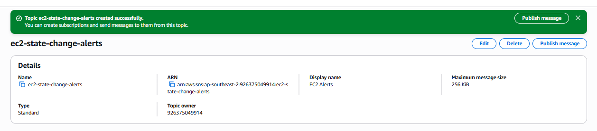

> The topic must be **Standard**. A first attempt was accidentally created as FIFO; FIFO topics only support SQS subscribers and offer no email protocol. Since a topic's type cannot be changed, the FIFO topic was deleted and recreated as Standard.

An **Email** subscription was added and confirmed through the link in the confirmation email. SNS does not deliver to an address until its owner confirms, which prevents SNS from being used to send unsolicited email. (The address is blurred in the screenshot.)

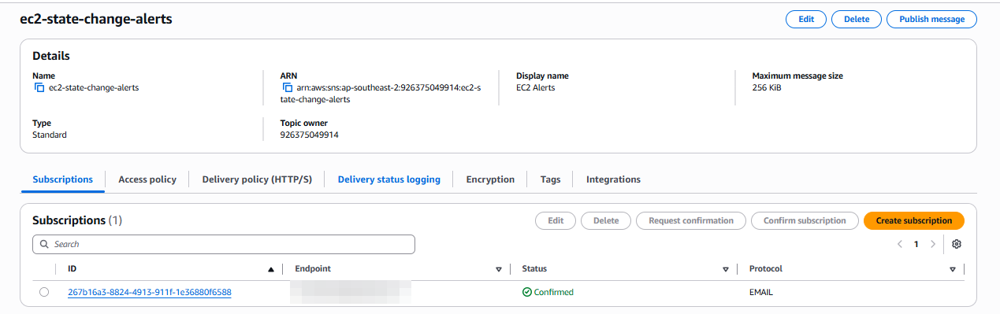

---

## Step 2: IAM role

| Policy | Purpose |
|---|---|
| `AmazonEC2ReadOnlyAccess` | Look up the instance's `Name` tag. The function only reads from EC2, so read-only access is enough |
| `AmazonSNSFullAccess` | Publish to the SNS topic |
| `AWSLambdaBasicExecutionRole` | Write the function's logs to CloudWatch Logs |

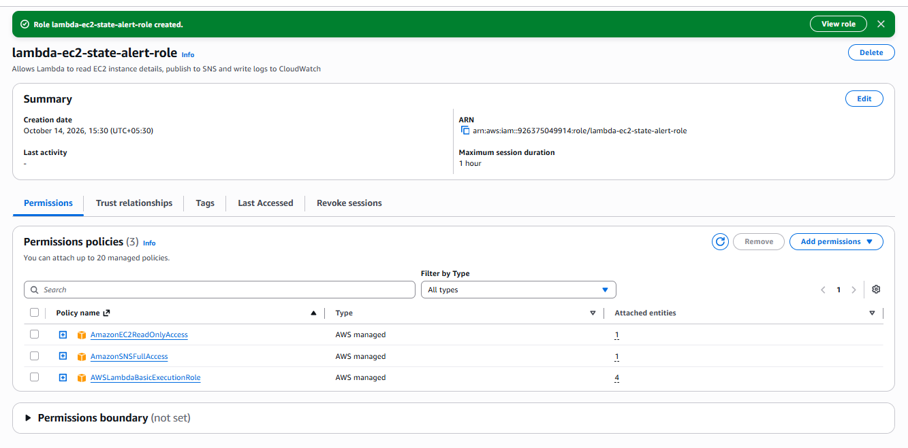

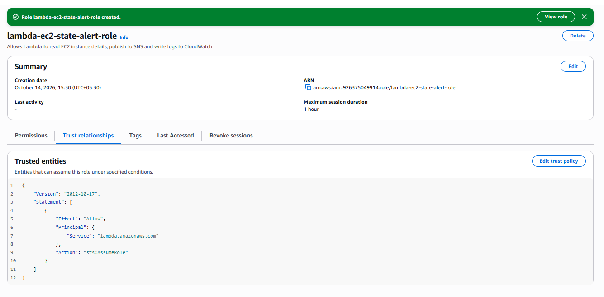

---

## Step 3: Lambda function

The function `ec2-state-change-alert` was created in Sydney and assigned the role `lambda-ec2-state-alert-role`.

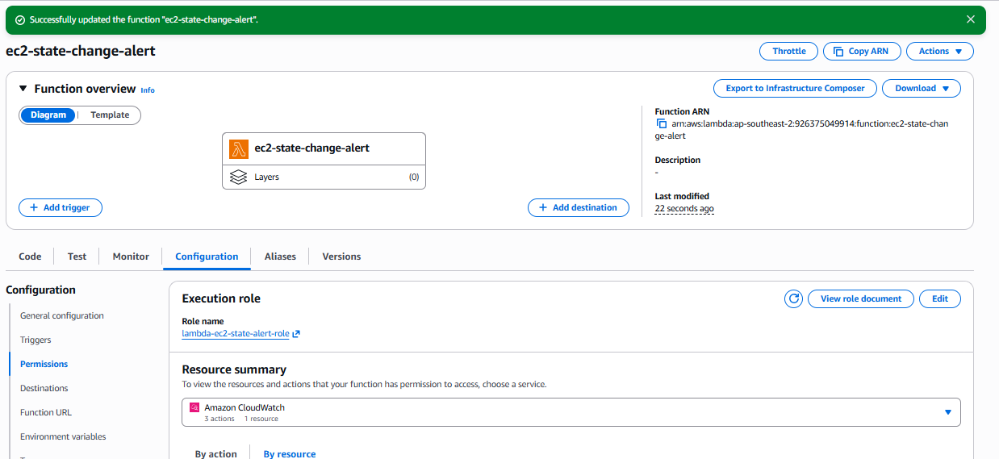

Timeout increased from 3 to 30 seconds:

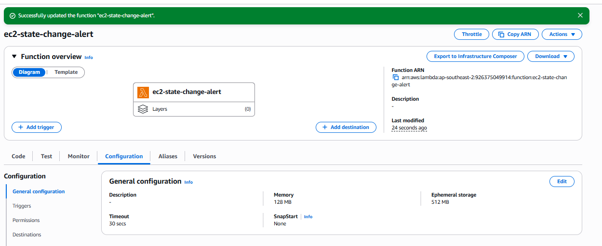

Environment variable:

| Key | Value |
|---|---|
| `SNS_TOPIC_ARN` | `arn:aws:sns:ap-southeast-2:926375049914:ec2-state-change-alerts` |

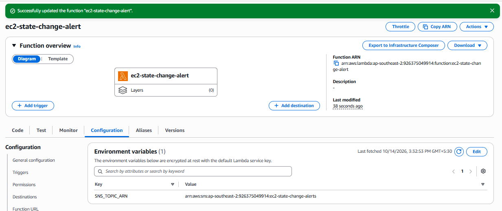

---

## Step 4: Code

Full source: [`lambda_function.py`](lambda_function.py)

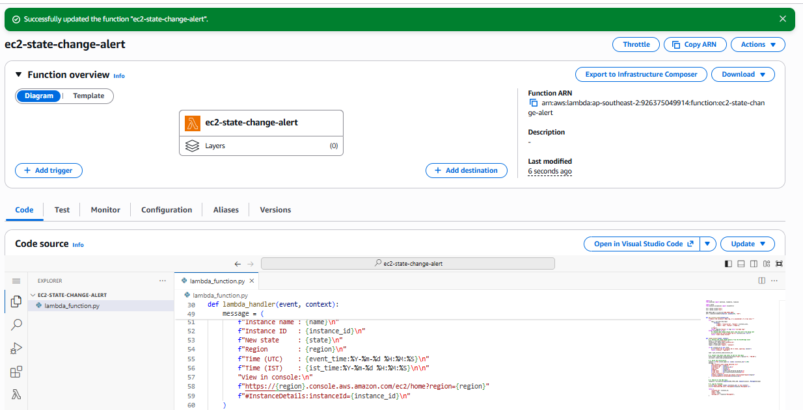

### Code walkthrough

1. **Read the event:** `detail.instance-id`, `detail.state` and `region` are read with `.get()`; an event missing these fields is logged and ignored rather than causing an error.
2. **Name lookup:** `get_instance_name()` calls `describe_tags` for the `Name` key and returns a placeholder if the instance has no name or the lookup fails.
3. **Time conversion:** the event's UTC `time` string is parsed with `datetime.fromisoformat` and converted to IST with a fixed +05:30 offset.
4. **Message:** the subject is truncated to 100 characters, the SNS limit for email subjects. The body uses aligned fields and includes a console deep link built from the event's region and instance ID.
5. **Publish:** `sns.publish` sends the message to the topic, and SNS delivers it to every confirmed subscriber. The returned `MessageId` is logged so each email can be traced.

---

## Step 5: EventBridge rule

The trigger was added from the Lambda console as a new EventBridge rule, `ec2-state-change-alert`. The intended pattern:

```json
{
  "source": ["aws.ec2"],
  "detail-type": ["EC2 Instance State-change Notification"],
  "detail": {
    "state": ["running", "stopped"]
  }
}
```

A list in an event pattern means OR, so the rule matches when the state is `running` or `stopped`.

### Issue found and fixed

The Lambda console's trigger form does not allow editing the pattern JSON directly, and the rule was saved with the wrong event source. When the rule was opened in the EventBridge console, the visual builder flagged a mismatch between the selected event type (Auto Scaling) and the pattern:

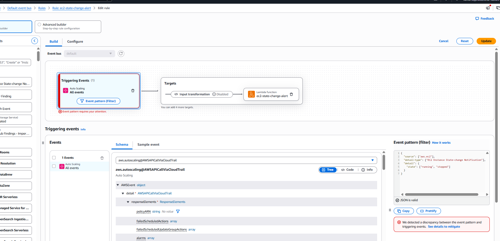

The saved pattern was only `{"source": ["aws.autoscaling"]}`. The rule showed as **Enabled** and looked healthy, but it would never have matched an EC2 state change:

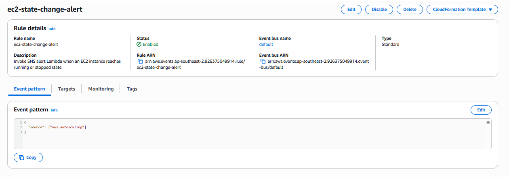

The rule was edited in the EventBridge console and the pattern corrected. The function's trigger list now shows the correct pattern, and the existing invoke permission for `events.amazonaws.com` remained valid:

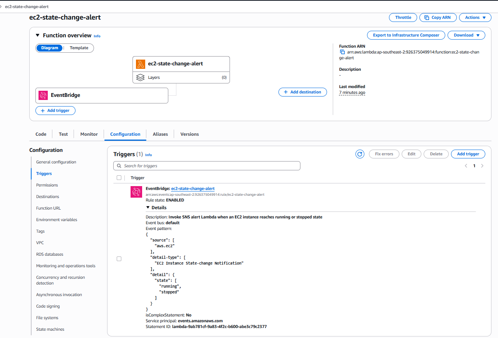

**Lesson learned:** after creating a trigger, always verify the saved configuration rather than assuming the form captured it correctly. An enabled rule that never fires produces no error, so the fault would only have shown up as missing alerts.

---

## Step 6: Testing

### Test 1: manual start

`lab-auto-stop` was started manually from the EC2 console.

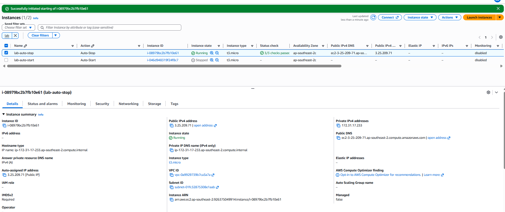

The alert arrived with the instance name, state, and correctly converted time (10:33:32 UTC = 16:03:32 IST). The first message from `no-reply@sns.amazonaws.com` was placed in the junk folder; it was marked as "not junk" so later alerts arrived in the inbox.

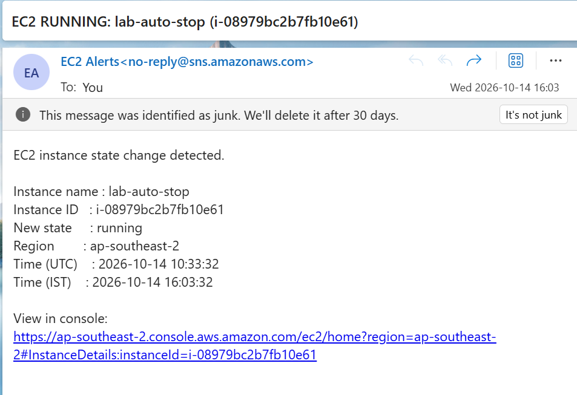

### Test 2: changes made by another automation

With `lab-auto-stop` running and `lab-auto-start` stopped, the **Assignment 1** function (`ec2-tag-start-stop`) was invoked. In a single run, it stopped `lab-auto-stop` and started `lab-auto-start`:

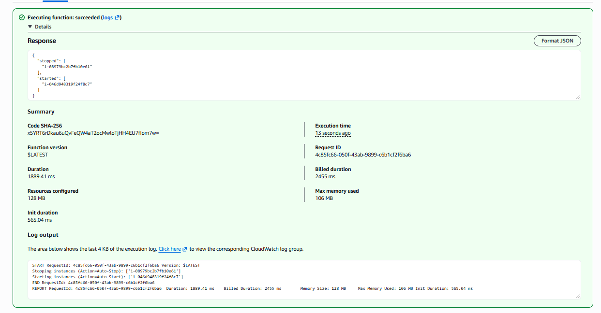

Both state changes produced an alert, showing that one automation's actions are monitored by another:

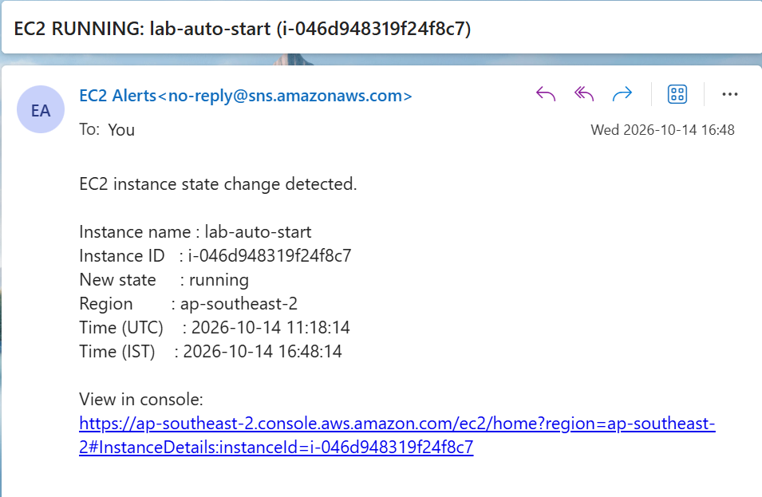

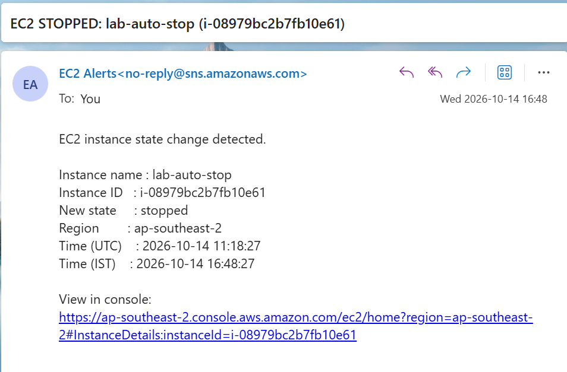

| Time (UTC) | Alert | Note |
|---|---|---|
| 11:18:14 | `EC2 RUNNING: lab-auto-start` | Starting completes quickly |
| 11:18:27 | `EC2 STOPPED: lab-auto-stop` | 13 s later, although the stop command was sent first, because stopping takes longer |

### Lambda logs

Both invocations appear in the same log stream, each with the state change and the SNS MessageId:

```
State change: lab-auto-start (i-046d948319f24f8c7) is now running
Published SNS alert, MessageId=d6c496aa-139b-5446-b2fd-f5e374a35196
State change: lab-auto-stop (i-08979bc2b7fb10e61) is now stopped
Published SNS alert, MessageId=f17baf42-e1a6-5e5e-abbf-cc0b86e58dd4
```

The first invocation includes a cold start (`INIT_START`, 1104 ms billed). The second reused the warm execution environment, with no init phase and only 452 ms billed.

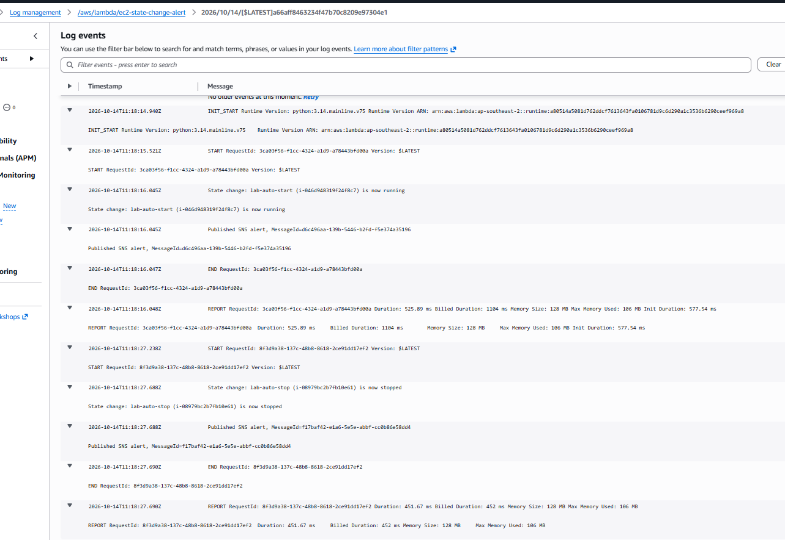

---

## Security and production notes

**Least privilege.** The managed policies grant far more than needed. A production policy would allow only reading tags and publishing to this one topic:

```json
{
  "Version": "2012-10-17",
  "Statement": [
    {
      "Effect": "Allow",
      "Action": "ec2:DescribeTags",
      "Resource": "*"
    },
    {
      "Effect": "Allow",
      "Action": "sns:Publish",
      "Resource": "arn:aws:sns:ap-southeast-2:926375049914:ec2-state-change-alerts"
    }
  ]
}
```

**Encryption.** The SNS topic can be encrypted at rest with a KMS key. If a customer-managed key is used, the Lambda role also needs `kms:GenerateDataKey` and `kms:Decrypt` on that key.

**Alert delivery.** Email alerts can be filtered as junk; in production, the SNS sender address would be allow-listed, and critical alerts would also go to a channel such as Slack, Microsoft Teams, or an on-call tool.

**Without Lambda.** EventBridge can target an SNS topic directly, with an input transformer to format the message. Lambda is used here because the assignment requires it, and because it allows enrichment such as the `Name` tag lookup and IST time conversion.
